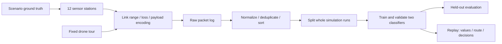

# Drone Sensor Lab

A runnable teaching baseline for **Real-Time Dashboard for Drone-Collected Data: Aggregation and Analytics**. A virtual drone follows a fixed 2D route past 12 stationary sensor stations. Each station measures temperature, humidity, a smoke proxy and carbon monoxide. Three simplified wireless profiles determine which samples reach the drone. Python normalizes the payloads, compares two fire classifiers, and displays recommendations in an animated dashboard.

The default scenario is forest-fire detection. Flood prediction is a student extension, not an implemented feature. No real drone, Bluetooth adapter, WiFi radio, ROS, Gazebo or database is needed. A live 3D viewer now uses the Crazyflie mesh from gym-pybullet-drones and streams newly generated sensor data into CSV.

Start with the [project overview](PROJECT_OVERVIEW.md), [student tasks and report](Tasks.md), and [Python practices](python_skill.md).

## Docker Compose

Run `docker compose --profile camera up --build -d` from this folder. Open the viewer and click **Camera view**. See [the Compose guide](docs/COMPOSE.md) for batch collection, classifier selection, camera controls and model updates.

## Live 3D drone and streaming CSV

For all native uv/npm commands, work inside simulation/. Docker Compose commands run at the repository root. After generating the first model with the command below, run:

```powershell
uv run drone-live --model artifacts/demo/model.joblib --port 8765
```

Open [the 3D viewer](http://127.0.0.1:8765). Click **Start collection** and **Follow**. The drone moves through the scene while normalized sensor rows are appended to `artifacts/live/<session-id>/readings.csv`. **Download CSV** works during collection. For the next training step, use **Prepare 15 mixed tours**, wait for completion, then run:

```powershell
uv run drone-train --input artifacts/live/SESSION-ID/readings.csv --output artifacts/live-training
```

Replace `SESSION-ID` with the displayed session. See [LIVE_3D.md](docs/LIVE_3D.md) for streaming semantics, the CSV contract and larger training runs. This is prescribed 3D motion using a real drone mesh, not a flight-dynamics simulation.

## Configure a fleet

Choose Forest, Meadow or Desert, set **Drones** (1-8) and **Tours per drone** (1-300). Under **Customize field and collection**, set field width (150-600 m), stations (6-60), vegetation and samples per tour. Preview before collecting. Presets affect synthetic temperature/humidity and appearance; vegetation changes scenery only.

Drones start at different points on the same closed route. Each station attempts one transmission per sample to its nearest drone. The CSV identifies the collector in `drone_id` (zero-based; UI labels start at 1). All drones in a tour share a `run_id`. Select a drone and click **Follow**; drag to orbit and scroll, pinch, or use the +/- buttons to zoom. **Free orbit** releases the camera; **Overview** returns to the field.

## Reproduce the lab

Prerequisites: Git and [uv](https://docs.astral.sh/uv/getting-started/installation/). Commands below work in PowerShell from the project root. Python 3.12 is selected by `.python-version`.

```powershell
git clone --branch main --single-branch https://github.com/Hananeaoujil/real-time-dashboad-for-drone-collected-data-aggregation-and-analytics-.git
cd real-time-dashboad-for-drone-collected-data-aggregation-and-analytics-
cd simulation
uv python install 3.12
uv sync --locked --all-groups
uv run drone-lab --runs 90 --steps 120 --seed 42 --output artifacts/demo
uv run drone-live --model artifacts/demo/model.joblib --port 8765
```

This version is on branch `main`. Open **http://127.0.0.1:8765**, click **Start collection**, then **Follow**. Use **Prepare 15 mixed tours** to collect a labeled training CSV. Stop the server with Ctrl+C.

Generated datasets, trained models, virtual environments and external repository clones are excluded from Git. The generation command above creates the first model locally. The required 3D mesh and JavaScript libraries are included, so Node.js, npm and the external simulator clones are not needed to run the viewer.

For the optional recorded-data dashboard, run this in another terminal:

```powershell
uv run streamlit run dashboard.py --server.address 127.0.0.1 -- artifacts/demo
```

Open the localhost URL printed by Streamlit. Choose a scenario and run, move the start slider, or enable **Play tour**. This dashboard replays recorded arrivals, advancing two simulation seconds per wall-clock second. The separate `drone-live` command provides the live producer/consumer service and 3D scene.

The output directory must be empty or new to protect earlier experiments. For another run:

```powershell
uv run drone-lab --runs 300 --steps 120 --seed 2026 --output artifacts/experiment-2026
uv run streamlit run dashboard.py -- artifacts/experiment-2026
```

Use a multiple of three runs, at least 15, and at least 30 time steps. Increasing steps also lengthens the tour because the sampling interval stays two seconds; it changes drone speed. Hold steps fixed when comparing dataset sizes.

## What the project does



1. **Scenario model:** each experiment includes equal numbers of normal, fire, and nuisance tours. Fire begins at a randomized time and affects six stations. Nuisance events raise the smoke proxy without the same CO/temperature pattern. Labels come from the scenario state, not an alarm threshold applied to the measured features.
2. **Collection:** at each two-second sample, the drone receives a station's current reading only if it is in range and survives random link loss. There is no station buffer or retransmission. Every scheduled sample is logged as received, lost, or out of range.
3. **Aggregation:** Bluetooth-style centi-units, WiFi-style Fahrenheit JSON, and a custom Kelvin/fraction payload become Celsius, percent and ppm. Lost values are never recovered from simulator ground truth. Duplicates are removed and timestamps sorted. Missing measurement values stay missing until the model's training-fitted imputer handles them.
4. **Learning:** logistic regression and random forest use only the four measurements. Run IDs, scenario names, labels, timestamps and protocol names are excluded from model inputs. Whole runs are split 60/20/20 within each scenario. Validation chooses the model and cutoff using a teaching cost of `5 × missed fires + false alarms`; test results do not choose the winner.
5. **Decision:** complete readings above the chosen cutoff produce `ALARM`; those below produce `NO_ALARM`. Missing measurements, unvisited stations and readings older than 30 simulation seconds produce a coverage `WARNING`. These are classroom decisions, not operational emergency instructions.

## Files and results

| Path | Purpose |
|---|---|
| `simulation/src/drone_lab/simulation.py` | Sensors, latent events, route, link parameters and encoders |
| `simulation/src/drone_lab/aggregation.py` | Payload decoding, units, schema bounds, deduplication, summaries |
| `simulation/src/drone_lab/analytics.py` | Run split, training, validation cutoff, test metrics and `predict()` |
| `simulation/src/drone_lab/visuals.py` | Export route, signals, link outcomes and confusion matrix |
| `simulation/src/drone_lab/streaming.py` | Incremental producer, arrival queue, CSV writer and state snapshots |
| `simulation/src/drone_lab/server.py` | Local API, SSE streaming, start/stop and downloads |
| `simulation/src/drone_lab/web/` | 3D drone, forest, station markers and telemetry controls |
| `simulation/dashboard.py` | Streamlit replay with moving drone and current station status |
| `simulation/tests/` | Behavior and integration checks |
| `docs/SCENARIO.md` | Exact assumptions, units and interpretation |
| `docs/VALIDATION.md` | Commands executed, measured results and limitations |
| `docs/UPSTREAM.md` | Optional UavNetSim clone and tested analytical-mode command |
| `Tasks.md` | Student phases, commands, deliverables and acceptance criteria |
| `.agents/skills/python-production/` | Reusable Python skill and the supplied full reference guide |

Each generated output folder contains `raw.jsonl`, `manifest.json`, `readings.csv`, `tour_summary.csv`, `train.csv`, `validation.csv`, `test.csv`, `model.joblib`, `metrics.json`, `decisions.csv`, and `overview.png`. IDs and labels remain in CSVs for auditing; train only with the feature allowlist in `analytics.py`. Load only model files you trust: joblib is not a safe interchange format for untrusted uploads.

## Is there enough training data?

The baseline generates tens of thousands of received samples and scales through `--runs`. That is enough to exercise the classroom pipeline and compare simple models. It does **not** establish sufficient real-world coverage: adjacent readings are correlated, there are only 12 fixed sites, and all readings follow one synthetic generator. More rows are not equivalent to more independent environments.

Inspect class counts, per-scenario test results and the validation learning curve in `metrics.json`. Repeat with different seeds, hold out complete environments/sensor layouts, and validate on independently measured data before making practical detection claims. The nuisance case is only one family of confounders. Public datasets need verified licensing, physical units, matching sensor channels and a documented label mapping; none was silently downloaded or treated as interchangeable with smoke ppm here.

## Development checks

```powershell
uv run ruff check .
uv run ruff format --check .
uv run mypy src
uv run pytest -q
```

Use [the Python skill](.agents/skills/python-production/SKILL.md) for future Python work. The stack is intentionally small: additional service, database, Docker and security infrastructure should follow actual requirements.
